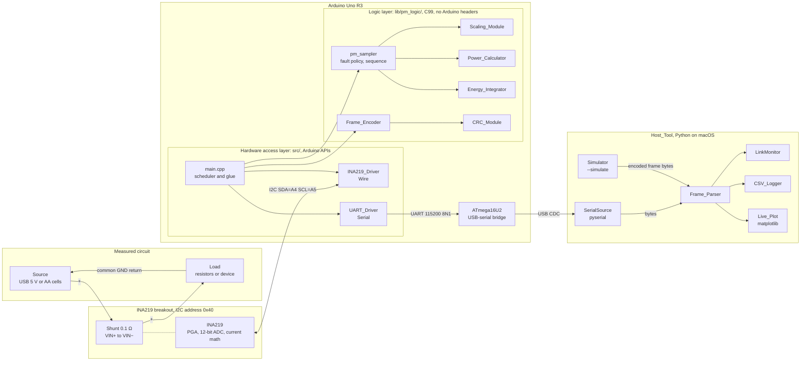
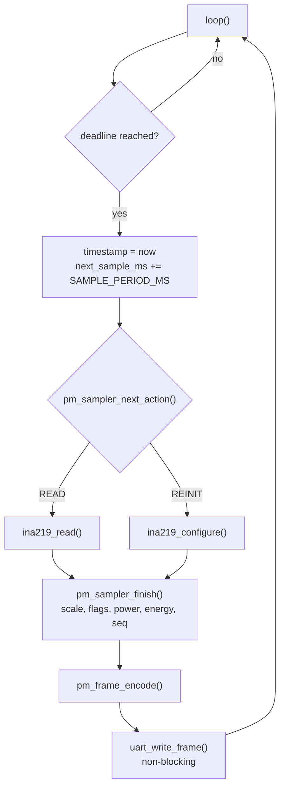
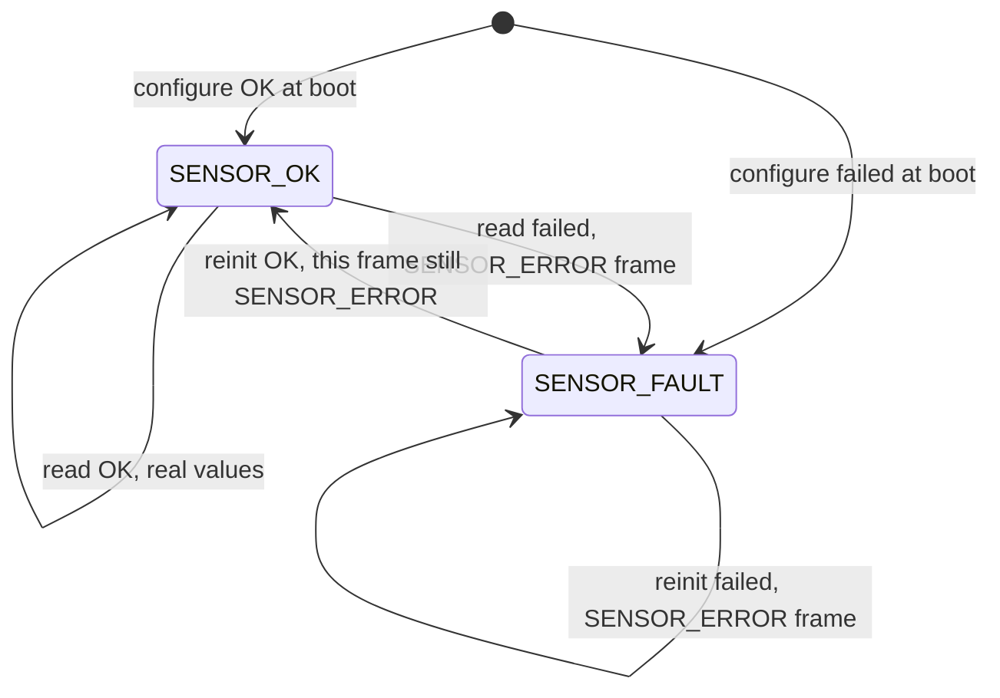
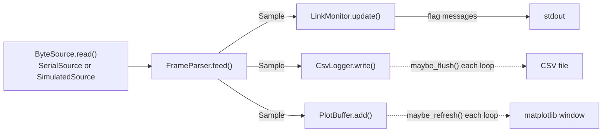

# Design Document: Power Monitor

## Overview

The Power Monitor is an Arduino Uno R3 that reads an INA219 current/voltage sensor over I2C, converts the raw registers to integer engineering units, integrates energy, and streams one 25-byte checksummed Frame per Sample over UART at 115200 baud. A Python Host_Tool on macOS parses the stream, counts link errors, logs to CSV, and plots live. A `--simulate` mode drives the same host pipeline with synthetic Frames so everything except the sensor can be built and tested before the INA219 arrives.

The firmware has two layers:

- **Hardware access** (`src/`): `INA219_Driver` (Arduino Wire), `UART_Driver` (Arduino Serial), and `main.cpp` (scheduler and glue). These are the only files that include Arduino headers, and every function that touches hardware returns a `pm_status_t`.
- **Logic** (`lib/pm_logic/`, C99): Scaling_Module, Power_Calculator, Energy_Integrator, Frame_Encoder, CRC_Module, plus `pm_sampler` (per-Sample fault policy and sequence numbering, see below). These include only `<stdint.h>`, `<stdbool.h>`, and `<stddef.h>`, so they compile for both the ATmega328P and macOS. On the Mac they are tested with Unity (`pio test -e native`) and with hypothesis through Python's built-in `ctypes`.

All firmware math is integer. Register counts become exact integers in mV and µA. Power uses a 64-bit intermediate and one rounded division. Energy accumulates exactly in a 64-bit picojoule counter and is divided once when reported, so rounding never accumulates.

### Key design decisions

| Decision | Choice | Why |
|---|---|---|
| Sensor driver | Own register-level driver on Wire | The Adafruit library uses `float`; our own driver keeps every scaling step integer and visible. |
| Current LSB | 100 µA, CAL = 4096 | Equals the INA219's physical step (10 µV shunt LSB ÷ 0.1 Ω). See corrections below. |
| Units on the wire | mV (u16), µA (i32), mW (i32), µWh (i32) | Exact integers derived from registers; no floats anywhere in firmware. |
| Energy accumulator | `int64_t` in pJ (= mV·µA·ms), one division when reported | Every per-interval product is an exact integer, so the running total is exact. |
| Frame | 25 bytes fixed, sync `AA 55`, little-endian, CRC-8/SMBUS | Simple to parse and to resynchronize; 10.9% of UART capacity at 50 Hz. |
| CRC implementation | Bitwise loop, no table | On AVR a `const` 256-byte table is copied to SRAM unless placed in `PROGMEM`; that would be 25% of our RAM budget. |
| Logic language | C99 with `extern "C"` guards | Unity is C, `ctypes` loads C symbols without C++ name mangling, and both avr-gcc and Apple clang compile it. |
| Compile-time checks | `#if` / `#error` | Works identically in C and C++ and prints a message naming the constant (Req 6.2, 6.3). |
| Per-Sample decisions | Pure `pm_sampler` in the logic library | Fault flags, re-init policy, and sequence numbering are logic; putting them in `main.cpp` would make Req 2 and 7.5/7.6 untestable without hardware. |
| Host loop | Single-threaded | matplotlib's macOS backend must run on the main thread, and 1.25 kB/s at 50 Hz needs no concurrency. |

`pm_sampler` is not a new capability. The requirements' glossary lists five Logic_Modules; `pm_sampler` is the testable home for decisions the requirements assign to "the Firmware" (Req 2.2–2.6, 5.1, 6.5, 7.5, 7.6), following the steering rule that logic must be separated from hardware access.

### Corrections to the initial guidance

These came up while checking the suggested design against the INA219 datasheet and the Arduino AVR core source.

1. **Current LSB 50 µA → 100 µA.** The INA219 computes `Current = Shunt × CAL / 4096`. The shunt register LSB is 10 µV, which is 100 µA through 0.1 Ω. With CAL = 8192 (50 µA LSB) the current register is exactly `2 × shunt`, so every reading is even and the extra bit is always zero. CAL = 4096 (100 µA LSB) gives the same physical resolution with a 1:1 mapping, which is easier to explain and still meets Req 1.2 (100 µA or finer).
2. **BRNG = 16 V does not improve resolution.** The bus voltage LSB is 4 mV in both the 16 V and 32 V ranges. 16 V is chosen only because it is the smallest range that covers 6 V.
3. **mV × µA is nW, not µW.** Power is `(mV × µA) / 10^6` mW. The design uses one rounded division instead of two, because rounding twice can move a result by more than half an LSB (example in the Power_Calculator section).
4. **The Wire timeout is per wait loop, not per transaction.** In `twi.c` each busy-wait loop restarts its own timer. A wedged transaction is aborted about 5 ms after progress stops; a pathological transaction could take up to about 10 ms before abort. The INA219 does not clock-stretch, so a healthy read takes about 0.5 ms. Both bounds are below the 20 ms period at 50 Hz (Req 2.1).
5. **64-bit `p × dt` can overflow for arbitrary inputs.** `|mV × µA|` needs up to 48 bits and `dt` up to 32 bits, so the product can exceed `int64_t`. The Energy_Integrator checks before multiplying (see below). In normal operation `dt ≈ 100 ms` and this never triggers, but the pure function must be correct for every input the property tests generate.
6. **Golden Vector 1 originally had CRC = `0x00`.** A zero CRC byte would not catch an encoder that forgets to write the CRC. The energy value was changed so GV1's CRC is `0x77`.

### Research summary

- **INA219 datasheet** ([TI SBOS448G](https://www.ti.com/lit/ds/symlink/ina219.pdf)): configuration bit fields (BRNG bit 13, PG bits 12–11, BADC bits 10–7, SADC bits 6–3, MODE bits 2–0, reset value `0x399F`); shunt LSB 10 µV; bus register holds the reading in bits 15–3 with CNVR in bit 1 and OVF in bit 0; `Cal = trunc(0.04096 / (Current_LSB × R_shunt))`; calibration bit 0 is read-only zero; 12-bit conversion 532 µs typ / 586 µs max. Accuracy for the looser INA219A grade: shunt offset ±30 µV typ / ±150 µV max at PGA /4, current and bus voltage error ±0.2% typ / ±0.5% max at 25 °C. The error budget uses the A grade, so a B-grade part (±75 µV max offset at /4) only adds margin.
- **Arduino AVR core Wire library** ([Wire.h](https://github.com/arduino/ArduinoCore-avr/blob/master/libraries/Wire/src/Wire.h), [twi.c](https://github.com/arduino/ArduinoCore-avr/blob/master/libraries/Wire/src/utility/twi.c)): `setWireTimeout(timeout_us, reset_with_timeout)` exists on AVR (added in the 2020 timeout rework; to my knowledge first released in core 1.8.3). `endTransmission()` returns 0 success, 1 too long, 2 address NACK, 3 data NACK, 4 other error, 5 timeout. Buffers are 32 bytes. Timeouts are off by default.
- **PlatformIO**: [platform-atmelavr 5.3.0](https://github.com/platformio/platform-atmelavr/releases) ships Arduino AVR core 1.8.8, which has the timeout API. [platform-native 1.2.1](https://github.com/platformio/platform-native/releases) is current. [`test_build_src`](https://docs.platformio.org/en/latest/projectconf/sections/env/options/test/test_build_src.html) defaults to `no`, so `src/` is not compiled for tests. [`test_ignore`](https://docs.platformio.org/en/latest/projectconf/sections/env/options/test/test_ignore.html) accepts `*`.
- **CRC-8/SMBUS** ([reveng CRC catalogue](https://reveng.sourceforge.io/crc-catalogue/1-15.htm)): width 8, poly `0x07`, init `0x00`, no reflection, xorout `0x00`, check `0xF4`, residue `0x00`. The check value and all Golden_Vector CRCs were computed locally with three independent methods (bitwise, table, polynomial long division) and agreed.
- **Uno clock**: the ATmega328P runs from a Murata CSTCE16M0V53-R0 ceramic resonator, [±0.5% tolerance](https://www.digikey.com/en/products/detail/murata-electronics/CSTCE16M0V53-R0/584406). This enters the energy error budget.
- **Toolchain check**: Apple clang 21 on this Mac accepts `-fsanitize=signed-integer-overflow -fsanitize-trap=signed-integer-overflow` in a `ctypes`-loaded library and traps on overflow, which is how "no intermediate overflow" (Req 4.3) is made observable in tests.
- **Host package versions** (checked with `pip index versions`): pyserial 3.5, matplotlib 3.11.2, pytest 9.1.1, hypothesis 6.168.3.

Content from these sources was rephrased for compliance with licensing restrictions.

## Architecture

### Block diagram



### Hardware/logic boundary

- Only `src/ina219_driver.cpp` includes `<Wire.h>`. Only `src/uart_driver.cpp` uses `Serial`. `src/main.cpp` includes `<Arduino.h>` for `setup()`, `loop()`, and `millis()`.
- Files in `lib/pm_logic/` include only standard integer/bool/size headers. A host test (`test_firmware_rules.py`) scans the sources and fails if this is violated, and the native build fails anyway because the Arduino headers do not exist there (Req 15.1).
- Data crosses the boundary as plain integers: two raw `uint16_t` registers in, a 25-byte array out.

### Wiring

| # | From | To | Purpose and notes |
|---|---|---|---|
| 1 | Uno **5V** | INA219 **VCC** | Chip supply (INA219 accepts 3.0–5.5 V). The breakout's SDA/SCL pull-ups go to this rail, so the bus idles at 5 V, matching Uno logic levels. |
| 2 | Uno **GND** | INA219 **GND** | Common ground for I2C and for the bus voltage measurement. |
| 3 | Uno **A4 (SDA)** | INA219 **SDA** | I2C data. The R3's dedicated SDA header pin near AREF is the same signal. |
| 4 | Uno **A5 (SCL)** | INA219 **SCL** | I2C clock, 100 kHz. |
| 5 | Source **+** | INA219 **VIN+** | Supply end of the shunt (high side). |
| 6 | INA219 **VIN−** | Load **+** | Load end of the shunt. Bus_Voltage is measured here. |
| 7 | Source **−** and Load **−** | Uno **GND** | One ground for source, load, sensor, and Uno. |
| – | INA219 **A0, A1** | leave at default (GND) | I2C address `0x40`. |

**Why high-side.** The INA219 measures bus voltage from VIN− to its own GND pin. With the shunt between source + and load +, VIN− sits at the load voltage and the load's negative terminal stays at ground. With a low-side shunt, VIN− would sit near 0 V and Bus_Voltage would read about zero.

**Why a common ground.** Both the I2C signals and the bus voltage are referenced to the INA219 GND pin. If the source's negative terminal floats relative to it, the voltage reading is meaningless and the inputs can leave their allowed common-mode range.

**Sign convention.** Current flowing VIN+ → VIN− (source to load) is positive.

**Limits.** Never exceed 26 V on VIN+ or VIN− (datasheet maximum). The Rated_Range is 0–6 V, so the kit's 9 V battery is not used. Do not short a Li-ion cell when it is eventually connected; the verification in this spec uses only USB 5 V and AA cells.

### Firmware execution model

The firmware is a super-loop with a `millis()`-based fixed-rate schedule. There is no RTOS and no application interrupt; the only ISRs are the Arduino core's (Timer0 for `millis()`, USART, TWI).



Sensor fault state (Req 2.2–2.5):



A successful re-init still reports SENSOR_ERROR for that Sample because the INA219 needs one conversion pair (about 1.06 ms) after configuration before its registers hold valid data. The next Sample, one period later, reads normally (Req 2.5).

**Worst-case time per Sample** (must stay below the 20 ms period at 50 Hz):

| Step | Typical | Worst case |
|---|---|---|
| Two register reads at 100 kHz (pointer write + 2-byte read each) | ≈ 1 ms | ≈ 10 ms (one aborted transaction; the driver stops at the first failure) |
| Logic (64-bit multiply/divide via libgcc, CRC over 22 bytes) | < 0.5 ms | < 0.5 ms |
| Copy 25 bytes into the Serial TX ring buffer | < 0.1 ms | < 0.1 ms (never waits, see UART_Driver) |
| **Total** | ≈ 1.5 ms | ≈ 11 ms |

Because the worst case is below the minimum period, a backlog cannot build up, so the scheduler needs no catch-up logic. The TX interrupt drains a Frame in 25 × 10 / 115200 s = 2.17 ms, which is the Req 8.2 bound (transmitted well before the next period).

`millis()` on a 16 MHz AVR advances by 1 ms per 1.024 ms Timer0 overflow and occasionally jumps by 2 to correct itself. Individual Timestamp intervals can therefore show ±1 ms jitter, but the fixed-rate schedule (`next_sample_ms += SAMPLE_PERIOD_MS`) keeps the mean interval exact (Req 6.4).

### Host architecture



One loop on the main thread: read available bytes (serial timeout 50 ms, or the simulator sleeps until its next Frame is due), feed the parser, dispatch each decoded Sample, then run the time-based housekeeping (CSV flush at least once per second, plot refresh every 0.5 s). `--simulate` swaps only the byte source, so simulated Frames go through the same `FrameParser` as serial bytes (Req 13.3).

When the host opens the serial port, macOS asserts DTR and the Uno auto-resets. The first Frames after opening can include the tail of a pre-reset Frame (discarded by the parser) followed by a Frame with `seq = 0` and a small Timestamp. `LinkMonitor` records that as a device reset rather than a burst of dropped Frames (Req 10.2).

### Repository layout

```text
power-monitor/
├── platformio.ini
├── src/                          # env:uno only: hardware access and glue
│   ├── main.cpp
│   ├── pm_config.h               # SAMPLE_RATE_HZ, UART and I2C settings, compile-time checks
│   ├── ina219_driver.h / .cpp    # the only file that includes <Wire.h>
│   └── uart_driver.h / .cpp      # the only file that uses Serial
├── lib/pm_logic/src/             # logic layer: built by env:uno and env:native
│   ├── pm_status.h               # pm_status_t
│   ├── pm_time.h / .c            # wrap-safe elapsed time and deadline check
│   ├── pm_scaling.h / .c         # Scaling_Module, shunt/LSB/CAL constants
│   ├── pm_power.h / .c           # Power_Calculator
│   ├── pm_energy.h / .c          # Energy_Integrator
│   ├── pm_frame.h / .c           # Frame_Encoder, frame constants, status flag bits
│   ├── pm_crc8.h / .c            # CRC_Module
│   └── pm_sampler.h / .c         # per-Sample fault policy and sequence numbering
├── test/                         # Unity suites: pio test -e native
│   ├── test_scaling/test_main.c
│   ├── test_power/test_main.c
│   ├── test_energy/test_main.c
│   ├── test_frame/test_main.c
│   ├── test_crc8/test_main.c
│   ├── test_sampler/test_main.c
│   └── test_time/test_main.c
├── host/
│   ├── requirements.txt          # exact pins
│   ├── power_monitor/
│   │   ├── __init__.py
│   │   ├── __main__.py           # python -m power_monitor
│   │   ├── protocol.py           # constants, Sample, crc8, encode_frame, decode_frame
│   │   ├── parser.py             # FrameParser (streaming, resync)
│   │   ├── link_monitor.py       # drops, resets, flag messages, summary
│   │   ├── csv_logger.py
│   │   ├── simulator.py
│   │   ├── live_plot.py          # PlotBuffer (pure) + LivePlot (matplotlib, lazy import)
│   │   └── cli.py                # argparse, run_session, main
│   └── tests/                    # pytest + hypothesis (see Testing Strategy)
└── docs/
    ├── packet_format.md          # Packet_Spec: Frame layout, CRC-8, Golden_Vectors (Req 14)
    └── verification_report.md    # written during hardware verification (Req 17)
```

### platformio.ini

```ini
; Two environments:
;   uno    - firmware for the Arduino Uno R3:     pio run -e uno -t upload
;   native - logic library + Unity tests on macOS: pio test -e native
[platformio]
default_envs = uno

[env:uno]
; Pinned: platform 5.3.0 ships Arduino AVR core 1.8.8, which has Wire.setWireTimeout().
platform = platformio/atmelavr@5.3.0
board = uno
framework = arduino
monitor_speed = 115200
; Unit tests run only on the Mac. Without this, `pio test` would try to upload tests to the board.
test_ignore = *

[env:native]
platform = platformio/native@1.2.1
test_framework = unity
; test_build_src defaults to "no", so src/ (main.cpp and the Arduino drivers) is never compiled here.
; lib/pm_logic is found by the Library Dependency Finder when a test #includes its headers.
build_flags =
    -Wall
    -Wextra
    ; Signed overflow is undefined behavior in C and usually wraps silently.
    ; Trap mode turns it into an immediate crash with no runtime library needed (Req 4.3, 5.4).
    -fsanitize=signed-integer-overflow
    -fsanitize-trap=signed-integer-overflow
```

Pinning the platforms pins the AVR toolchain and Arduino core. Unity is supplied by PlatformIO Core for `test_framework = unity`; its resolved version is printed by `pio test -v` and recorded in the README when the project is first built.

## Components and Interfaces

### Shared status codes (`pm_status.h`)

```c
typedef enum {
    PM_OK = 0,
    PM_ERR_I2C_NACK,         /* address or data not acknowledged: sensor missing or unpowered */
    PM_ERR_I2C_BUS,          /* lost arbitration, bus error, or oversized write */
    PM_ERR_I2C_TIMEOUT,      /* Wire timeout fired (no progress for I2C_TIMEOUT_US) */
    PM_ERR_I2C_SHORT_READ,   /* fewer bytes returned than requested */
    PM_ERR_SENSOR_VERIFY,    /* configuration read-back did not match what was written */
    PM_ERR_UART_BUSY,        /* TX buffer lacks room for a whole Frame; nothing written */
    PM_ERR_UART_WRITE,       /* Serial.write() accepted fewer bytes than requested */
    PM_ERR_BUFFER_TOO_SMALL  /* caller's buffer is shorter than a Frame */
} pm_status_t;
```

### INA219 configuration

| Register | Address | Use |
|---|---|---|
| Configuration | `0x00` | Written at init; read back to verify |
| Bus voltage | `0x02` | Read each Sample (bits 15–3 reading, bit 1 CNVR, bit 0 OVF) |
| Current | `0x04` | Read each Sample (signed, two's complement) |
| Calibration | `0x05` | Written at init; read back to verify |

The INA219 sends each 16-bit register **most significant byte first**. The driver reassembles `(msb << 8) | lsb`. (Our Frame format is little-endian; the two byte orders are independent.)

**Configuration value `0x119F`**

| Bits | Field | Value | Meaning |
|---|---|---|---|
| 15 | RST | 0 | no reset |
| 14 | – | 0 | unused |
| 13 | BRNG | 0 | 16 V full scale (smallest range covering 6 V; LSB is 4 mV either way) |
| 12–11 | PG | `10` | PGA /4, ±160 mV shunt range |
| 10–7 | BADC | `0011` | bus ADC 12-bit, 1 sample, 532 µs |
| 6–3 | SADC | `0011` | shunt ADC 12-bit, 1 sample, 532 µs |
| 2–0 | MODE | `111` | shunt and bus, continuous |

`0b0001_0001_1001_1111 = 0x119F`. It differs from the reset value `0x399F` only in BRNG (1→0) and PG (`11`→`10`).

> **Concept: PGA (programmable gain amplifier).** The INA219's shunt ADC natively spans ±40 mV. The PGA divides the input by 1, 2, 4, or 8 so larger shunt voltages fit. At the rated 1 A, the shunt drops 1 A × 0.1 Ω = 100 mV, which exceeds the /2 range (±80 mV). /4 (±160 mV) fits with headroom to about 1.6 A, so readings above the Rated_Range are measured (and flagged OVERRANGE) instead of clipping. /8 would also fit but has a worse offset spec (±200 µV vs ±150 µV max).

> **Concept: calibration register.** The INA219 can report current directly: internally it computes `Current_reg = Shunt_reg × CAL / 4096`. The datasheet's constant 0.04096 is that 4096 multiplied by the 10 µV shunt LSB (4096 × 10 µV = 0.04096 V). Setting `Current_reg × Current_LSB` equal to `Shunt_reg × 10 µV / R_shunt` and solving gives `CAL = 0.04096 / (Current_LSB × R_shunt)`.

In integer units, with Current_LSB in µA and R_shunt in mΩ: `0.04096 V / (I·10⁻⁶ A × R·10⁻³ Ω) = 40,960,000 / (I × R)`. Current_LSB is `CURRENT_LSB_UA = SHUNT_ADC_LSB_UV × UA_PER_MA / SHUNT_RESISTANCE_MOHM = 10 × 1000 / 100 = 100 µA`. With 100 µA and 100 mΩ, CAL = 4096 exactly. Current register = shunt register, and the INA219's internal multiply introduces no rounding.

### Scaling_Module (`pm_scaling.h/.c`)

```c
#define SHUNT_RESISTANCE_MOHM           100L
#define SHUNT_ADC_LSB_UV                10L         /* INA219 shunt voltage register LSB (datasheet) */
#define MAX_EXPECTED_CURRENT_UA         1000000L    /* Rated_Range: +/-1 A */
#define UA_PER_MA                       1000L
#define INA219_CURRENT_REG_MAX_COUNT    32767L      /* 2^15 - 1: largest positive signed 16-bit register value */
/* uV / mOhm = mA, so x UA_PER_MA gives uA. 10 uV / 100 mOhm = 100 uA, one shunt ADC step. */
#define CURRENT_LSB_UA                  (SHUNT_ADC_LSB_UV * UA_PER_MA / SHUNT_RESISTANCE_MOHM)
#define INA219_CAL_NUMERATOR_UA_MOHM    40960000L   /* 0.04096 V expressed in uA * mOhm */
#define INA219_CAL_VALUE  (INA219_CAL_NUMERATOR_UA_MOHM / (CURRENT_LSB_UA * SHUNT_RESISTANCE_MOHM))

#if ((SHUNT_ADC_LSB_UV * UA_PER_MA) % SHUNT_RESISTANCE_MOHM) != 0
#error "SHUNT_ADC_LSB_UV * UA_PER_MA must be divisible by SHUNT_RESISTANCE_MOHM, or CURRENT_LSB_UA is inexact"
#endif
/* Datasheet: Minimum_LSB = Max_Expected_I / 2^15. The register tops out at INA219_CURRENT_REG_MAX_COUNT
   counts, so CURRENT_LSB_UA * INA219_CURRENT_REG_MAX_COUNT is the largest positive current it can report. */
#if (CURRENT_LSB_UA * INA219_CURRENT_REG_MAX_COUNT) < MAX_EXPECTED_CURRENT_UA
#error "CURRENT_LSB_UA * INA219_CURRENT_REG_MAX_COUNT < MAX_EXPECTED_CURRENT_UA: current register cannot reach it; lower SHUNT_RESISTANCE_MOHM"
#endif
#if (INA219_CAL_NUMERATOR_UA_MOHM % (CURRENT_LSB_UA * SHUNT_RESISTANCE_MOHM)) != 0
#error "CURRENT_LSB_UA * SHUNT_RESISTANCE_MOHM must divide 40960000 exactly, or current scaling is inexact"
#endif
#if (INA219_CAL_VALUE > 0xFFFE) || ((INA219_CAL_VALUE % 2) != 0)
#error "INA219_CAL_VALUE must be even and fit in 16 bits (calibration bit 0 is read-only zero)"
#endif

#define BUS_VOLTAGE_LSB_MV          4
#define BUS_REG_READING_SHIFT       3        /* bits 15..3 hold the reading */
#define BUS_REG_OVF_MASK            0x0001u  /* math overflow flag */
#define RATED_BUS_VOLTAGE_MAX_MV    6000
#define RATED_CURRENT_MAX_UA        MAX_EXPECTED_CURRENT_UA  /* one source of truth for 1 A */

typedef struct { uint16_t bus_reg; uint16_t current_reg; } pm_raw_reading_t;

uint16_t pm_scale_bus_voltage_mv(uint16_t bus_reg);   /* (bus_reg >> 3) * 4, max 32764 mV */
int32_t  pm_scale_current_ua(uint16_t current_reg);   /* signed16(current_reg) * CURRENT_LSB_UA */
bool     pm_bus_math_overflow(uint16_t bus_reg);      /* OVF bit */
bool     pm_is_overrange(uint16_t bus_voltage_mv, int32_t current_ua);
```

- The `L` suffixes matter: `int` is 16 bits on AVR, so an unsuffixed `1000 * 100` would overflow at compile time. The preprocessor evaluates `#if` in at least 64-bit arithmetic, so the checks themselves are safe.
- `CURRENT_LSB_UA` is derived from the shunt ADC step instead of rounded up from `MAX_EXPECTED_CURRENT_UA / 32767` (≈ 30.5 µA), because an LSB finer than the physical step adds no resolution (Corrections item 1); `MAX_EXPECTED_CURRENT_UA` is used for the headroom check the datasheet procedure requires (Req 3.5).
- The current register is decoded with an explicit two's-complement rule, `raw >= 0x8000 ? (int32_t)raw - 65536 : (int32_t)raw`, instead of casting to `int16_t`. Converting an out-of-range value to a signed type is implementation-defined in C99; the explicit form means the same thing on every compiler.
- Output ranges: Bus_Voltage 0…32,764 mV (fits `uint16_t`); Current −3,276,800…+3,276,700 µA (fits `int32_t`).
- `pm_is_overrange` returns true when `bus_voltage_mv > 6000` or `|current_ua| > 1,000,000`. Boundary values are in range.

> **Concept: fixed point.** Instead of storing 5.000 V as a float, store the integer 5000 with an agreed unit (mV). Arithmetic stays in integers, which is exact, fast on an 8-bit CPU without an FPU, and identical on the Mac and the AVR. The only design work is choosing units small enough for the needed resolution and types wide enough to never overflow.

### Power_Calculator (`pm_power.h/.c`)

```c
#define NW_PER_MW  INT64_C(1000000)
int32_t pm_power_mw(uint16_t bus_voltage_mv, int32_t current_ua);
```

```c
int64_t p_nw = (int64_t)bus_voltage_mv * current_ua;   /* mV x uA = nW, exact */
int64_t half = NW_PER_MW / 2;
/* Round half away from zero. C division truncates toward zero, so bias by half in the sign's direction. */
int64_t p_mw = (p_nw >= 0) ? (p_nw + half) / NW_PER_MW : (p_nw - half) / NW_PER_MW;
return (int32_t)p_mw;
```

Overflow analysis for the full representable input domain (Req 4.3):

| Quantity | Bound | Needs | Type used |
|---|---|---|---|
| `bus_voltage_mv` | 0 … 65,535 | 16 bits unsigned | `uint16_t` |
| `current_ua` | −2³¹ … 2³¹−1 | 32 bits signed | `int32_t` |
| `p_nw` | \|p\| ≤ 65,535 × 2³¹ ≈ 1.41 × 10¹⁴ | 48 bits signed | `int64_t` (max 9.22 × 10¹⁸) |
| `p_nw ± 500,000` | ≈ 1.41 × 10¹⁴ | 48 bits | `int64_t` |
| `p_mw` | ≤ 1.41 × 10⁸ | 28 bits signed | fits `int32_t` (max 2.15 × 10⁹) |

In practice (INA219 outputs) `|p| ≤ 32,764 mV × 3,276,800 µA ≈ 1.07 × 10¹¹ nW` (107 W), and inside the Rated_Range `|p| ≤ 6.0 × 10⁹ nW` (6000 mW).

Error: rounding to nearest gives `|p_mw − exact| ≤ 0.5 mW`, inside Req 4.2's ±1 mW. One division is used instead of nW → µW → mW because rounding twice can compound: 1,499,600 nW rounds to 1,500 µW, which rounds to 2 mW, while the exact value 1.4996 mW rounds to 1 mW.

### Energy_Integrator (`pm_energy.h/.c`)

**Units.** mV × µA × ms = 10⁻³ × 10⁻⁶ × 10⁻³ J = 10⁻¹² J = 1 pJ. Each interval's energy `V × I × dt` is therefore an exact integer number of picojoules. 1 µWh = 10⁻⁶ W × 3600 s = 3.6 × 10⁻³ J = 3.6 × 10⁹ pJ.

```c
#define PJ_PER_UWH              INT64_C(3600000000)
#define ENERGY_REPORT_MAX_UWH   INT32_MAX                         /* 2,147,483,647 uWh ~ 2147 Wh */
#define ENERGY_ACC_LIMIT_PJ     ((int64_t)ENERGY_REPORT_MAX_UWH * PJ_PER_UWH)  /* 7.73e18 pJ */

void    pm_energy_init(pm_energy_state_t *s);            /* acc = 0, no previous sample (Req 5.6) */
void    pm_energy_update(pm_energy_state_t *s, uint32_t timestamp_ms, bool sample_valid,
                         uint16_t bus_voltage_mv, int32_t current_ua);
int32_t pm_energy_uwh(const pm_energy_state_t *s);        /* acc / PJ_PER_UWH, truncated toward zero */
bool    pm_energy_is_saturated(const pm_energy_state_t *s);
```

`pm_energy_update` is called for every Sample, valid or not:

```c
if (sample_valid && s->prev_valid && !s->saturated) {
    uint32_t dt_ms = pm_elapsed_ms(s->prev_timestamp_ms, timestamp_ms);   /* modular, wrap-safe */
    int64_t  p_nw  = (int64_t)bus_voltage_mv * current_ua;                /* |p| < 2^47 */
    if (p_nw != 0 && dt_ms != 0) {
        uint64_t mag  = (p_nw > 0) ? (uint64_t)p_nw : (uint64_t)(-p_nw);
        uint64_t room = (p_nw > 0) ? headroom_up(s->acc_pj) : headroom_down(s->acc_pj);
        if (mag > room / dt_ms) {            /* mag * dt_ms would pass the limit */
            s->acc_pj = (p_nw > 0) ? ENERGY_ACC_LIMIT_PJ : -ENERGY_ACC_LIMIT_PJ;
            s->saturated = true;             /* latched until reset (Req 5.5) */
        } else {
            uint64_t delta = mag * dt_ms;    /* <= room, cannot overflow */
            s->acc_pj += (p_nw > 0) ? (int64_t)delta : -(int64_t)delta;
        }
    }
}
s->prev_valid = sample_valid;
s->prev_timestamp_ms = timestamp_ms;
```

- **Interval rule (Req 5.1).** Energy is added only when both the previous and the current Sample are valid (SENSOR_ERROR clear), using the later Sample's V and I over the elapsed interval (a right-endpoint Riemann sum). A Sample after an error only re-establishes the baseline time. OVERRANGE Samples are still integrated because their values are real measurements.
- **Wrap-safe time (Req 5.2).** `pm_elapsed_ms(prev, now)` is `(uint32_t)(now - prev)`. Unsigned subtraction in C is defined modulo 2³², so prev = 4,294,967,196 and now = 4 give 104 ms, which is correct across the `millis()` wrap.
- **Check before multiply.** For non-negative integers, `mag × dt ≤ room` exactly when `mag ≤ floor(room / dt)`, so comparing against `room / dt_ms` decides overflow without ever computing an overflowing product. `headroom_up(acc)` is the distance from `acc` to `+ENERGY_ACC_LIMIT_PJ`, computed in `uint64_t` in two cases (`acc ≥ 0`: `LIMIT − acc`; `acc < 0`: `LIMIT + (−acc)`), because the distance can reach 2 × 7.73 × 10¹⁸, which exceeds `INT64_MAX` but fits `uint64_t`. `headroom_down` is the mirror image.
- **Exactness (Req 5.3).** All products are exact integers and the accumulator never rounds, so the only rounding is the final `acc / PJ_PER_UWH`. Truncation toward zero gives an error below 1 µWh regardless of run length.
- **Net energy (Req 5.7).** Negative current gives negative `p_nw`, which decreases `acc`.
- **Saturation (Req 5.5).** Once the limit would be passed, `acc` is held at ±limit and `saturated` latches. Integration stops, because after clipping the total is no longer true; letting it move again would produce a value that looks valid but is not.

Capacity and headroom (Req 5.4):

| Quantity | Value |
|---|---|
| 300 h × 6 W | 1,800,000,000 µWh = 6.48 × 10¹⁸ pJ |
| Report/accumulator limit | 2,147,483,647 µWh = 7.73 × 10¹⁸ pJ (84% used by the 300 h case) |
| `INT64_MAX` | 9.22 × 10¹⁸ (accumulator is kept within ±limit, so never reached) |
| Largest normal interval (6 V × 1 A × 1000 ms at 1 Hz) | 6 × 10¹² pJ ≈ 1,667 µWh |
| `millis()` wrap period | 2³² ms ≈ 49.7 days, longer than the 300 h requirement |

### Wrap-safe time helpers (`pm_time.h/.c`)

```c
uint32_t pm_elapsed_ms(uint32_t earlier_ms, uint32_t later_ms) {
    return (uint32_t)(later_ms - earlier_ms);
}
/* True once now has reached deadline, valid while they are less than 2^31 ms (24.8 days) apart. */
bool pm_deadline_reached(uint32_t now_ms, uint32_t deadline_ms) {
    return (int32_t)(now_ms - deadline_ms) >= 0;
}
```

These are ordinary functions in a `.c` file rather than `static inline` in the header so that the `ctypes` property tests can call them (inline functions have no exported symbol). The call overhead is irrelevant at 50 Hz.

Comparing `now >= deadline` directly breaks at the wrap: if `now` is 4,294,967,290 and the next deadline has wrapped to 4, `now >= deadline` is already true and the Sample fires about 10 ms early. The signed difference treats the 32-bit counter as a circle and asks "is `now` at or ahead of `deadline` by less than half the circle".

Casting an unsigned value above `INT32_MAX` to `int32_t` is implementation-defined in C99; avr-gcc and clang both define it as two's-complement wrap, which is what this relies on. The native tests check the wrap cases on the Mac, and the same compiler family is used on the AVR.

### Frame_Encoder (`pm_frame.h/.c`)

```c
#define PM_FRAME_LEN_BYTES        25     /* plain integer so it works in #if */
#define PM_FRAME_SYNC0            0xAAu
#define PM_FRAME_SYNC1            0x55u
#define PM_FRAME_CRC_START_OFFSET 2      /* CRC covers the length byte ... */
#define PM_FRAME_CRC_OFFSET       24     /* ... through byte 23; CRC itself at 24 */
#define PM_FLAG_SENSOR_ERROR      0x01u
#define PM_FLAG_OVERRANGE         0x02u
#define PM_FLAG_ENERGY_SATURATED  0x04u

pm_status_t pm_frame_encode(const pm_sample_t *sample, uint8_t *out, size_t out_size);
uint16_t    pm_frame_next_seq(uint16_t seq);    /* (uint16_t)(seq + 1u): 65535 -> 0 */
```

- Returns `PM_ERR_BUFFER_TOO_SMALL` (writing nothing) if `out_size < 25`; otherwise writes exactly 25 bytes (Req 7.4).
- Fields are written with helpers `put_u16_le()` / `put_u32_le()` that store `value & 0xFF` first, then each higher byte (Req 7.2). Signed fields are converted to `uint32_t` first; that conversion is defined by C as modulo 2³², which yields the two's-complement bytes.
- The struct is never `memcpy`'d onto the wire. Struct padding and byte order are up to the compiler: `pm_sample_t` is 21 bytes on AVR (no padding) and 24 bytes on the Mac. Explicit shifts make the code the definition of the format.
- `pm_frame_next_seq` casts after adding because `uint16_t` is promoted to `int` before arithmetic; on the Mac `65535 + 1` is the `int` 65536, and the cast brings it back to 0.

### CRC_Module (`pm_crc8.h/.c`)

```c
#define PM_CRC8_POLY  0x07u   /* x^8 + x^2 + x + 1 (the x^8 term is implicit) */
#define PM_CRC8_INIT  0x00u
uint8_t pm_crc8(const uint8_t *data, size_t len);
```

```c
uint8_t crc = PM_CRC8_INIT;
for (size_t i = 0; i < len; i++) {
    crc ^= data[i];
    for (uint8_t bit = 0; bit < 8; bit++) {
        crc = (crc & 0x80u) ? (uint8_t)((crc << 1) ^ PM_CRC8_POLY) : (uint8_t)(crc << 1);
    }
}
return crc;
```

> **Concept: CRC.** Treat the bytes as one long binary number (a polynomial over bits), divide it by a fixed generator polynomial using XOR instead of subtraction, and keep the 8-bit remainder. The receiver recomputes the remainder; any mismatch means the bytes changed. Because the math is linear, whether an error is caught depends only on the error pattern, which makes the guarantees below provable.

Error detection for our 23-byte codeword (22 covered bytes + CRC), verified by enumeration while writing this design:

- All single-bit errors are detected (Req 9.6).
- All errors with an odd number of flipped bits are detected, because the polynomial has (x + 1) as a factor: `x⁸ + x² + x + 1 = (x + 1)(x⁷ + x⁶ + x⁵ + x⁴ + x³ + x² + 1)`.
- All burst errors of 8 bits or fewer are detected.
- Two-bit errors are missed only when the two bits are exactly 127 bits apart (57 of 16,836 pairs), because the degree-7 factor has period 127. UART noise usually corrupts bits within one character, so this is acceptable for this link.

**Bitwise vs table.** The loop costs about 176 shift/XOR steps per Frame (≈ 0.1 ms at 16 MHz). A 256-byte lookup table would be faster, but on the AVR's Harvard architecture a `const` array is copied into SRAM at startup unless marked `PROGMEM` and read with `pgm_read_byte()`. That is either 256 bytes of the 1024-byte RAM budget or extra AVR-specific code in a module that must also compile on the Mac.

### pm_sampler (`pm_sampler.h/.c`)

Holds the per-Sample decisions so they are testable without hardware.

```c
typedef enum { PM_ACTION_READ, PM_ACTION_REINIT } pm_sensor_action_t;

void pm_sampler_init(pm_sampler_t *s, bool sensor_configured);  /* seq = 0 (Req 7.6), energy = 0 */
pm_sensor_action_t pm_sampler_next_action(const pm_sampler_t *s); /* READ if sensor_ok, else REINIT */
void pm_sampler_finish(pm_sampler_t *s, uint32_t timestamp_ms, pm_sensor_action_t action,
                       pm_status_t driver_result, const pm_raw_reading_t *raw, pm_sample_t *out);
```

`pm_sampler_finish` rules:

| Action | Driver result | Sample fields | Sensor state after |
|---|---|---|---|
| READ | `PM_OK` | V, I scaled; P = `pm_power_mw(V, I)`; OVERRANGE if OVF bit or outside Rated_Range | OK |
| READ | not OK | SENSOR_ERROR; V = I = P = 0 (Req 2.2) | FAULT |
| REINIT | `PM_OK` | SENSOR_ERROR; V = I = P = 0 | OK: next Sample reads (Req 2.5) |
| REINIT | not OK | SENSOR_ERROR; V = I = P = 0 | FAULT: retry next period (Req 2.4) |

In every case it then calls `pm_energy_update(valid = (READ and PM_OK))`, sets ENERGY_SATURATED if the integrator is saturated, copies Energy and `timestamp_ms` (Req 6.5), assigns `seq = next_seq`, and advances `next_seq` with `pm_frame_next_seq` (Req 7.5). A Sample is produced on every call, so a Frame goes out every period even during faults (Req 2.3).

### INA219_Driver (`src/ina219_driver.h/.cpp`)

```cpp
#define INA219_I2C_ADDR          0x40
#define INA219_REG_CONFIG        0x00
#define INA219_REG_BUS_VOLTAGE   0x02
#define INA219_REG_CURRENT       0x04
#define INA219_REG_CALIBRATION   0x05
#define INA219_CONFIG_BRNG_16V              (0u << 13)
#define INA219_CONFIG_PGA_DIV4_160MV        (2u << 11)
#define INA219_CONFIG_BADC_12BIT            (3u << 7)
#define INA219_CONFIG_SADC_12BIT            (3u << 3)
#define INA219_CONFIG_MODE_SHUNT_BUS_CONT   (7u << 0)
#define INA219_CONFIG_VALUE  (INA219_CONFIG_BRNG_16V | INA219_CONFIG_PGA_DIV4_160MV | \
                              INA219_CONFIG_BADC_12BIT | INA219_CONFIG_SADC_12BIT | \
                              INA219_CONFIG_MODE_SHUNT_BUS_CONT)          /* 0x119F */

pm_status_t ina219_bus_begin(void);                  /* Wire.begin(); setClock(I2C_CLOCK_HZ);
                                                        setWireTimeout(I2C_TIMEOUT_US, true) */
pm_status_t ina219_configure(void);                  /* write CONFIG and CAL, read both back */
pm_status_t ina219_read(pm_raw_reading_t *out);      /* bus register, then current register */
```

Private helpers `write_reg16()` and `read_reg16()` map Wire results to status codes:

| Wire result | Status |
|---|---|
| `endTransmission()` = 0 | `PM_OK` |
| = 2 or 3 (address/data NACK) | `PM_ERR_I2C_NACK` |
| = 5 (timeout) | `PM_ERR_I2C_TIMEOUT` |
| = 1 or 4 | `PM_ERR_I2C_BUS` |
| `requestFrom()` returned ≠ 2 and `getWireTimeoutFlag()` | `PM_ERR_I2C_TIMEOUT` |
| `requestFrom()` returned ≠ 2 otherwise | `PM_ERR_I2C_SHORT_READ` |
| read-back ≠ written value | `PM_ERR_SENSOR_VERIFY` |

`read_reg16()` clears the Wire timeout flag before each transaction so a stale flag cannot misclassify a later failure. Each function returns at the first failure, so one Sample never waits on more than one aborted transaction. `reset_with_timeout = true` resets the TWI hardware after a timeout so the next period's transaction starts clean. The driver never retries within a period; the re-init policy lives in `pm_sampler`.

The configuration read-back catches a device that ACKs but did not keep the settings (for example a glitch during the write).

### UART_Driver (`src/uart_driver.h/.cpp`)

```cpp
pm_status_t uart_init(void);          /* Serial.begin(UART_BAUD_BPS, SERIAL_8N1); returns PM_OK */
pm_status_t uart_write_frame(const uint8_t *frame, size_t len);
```

- `uart_write_frame` returns `PM_ERR_UART_BUSY` without writing if `Serial.availableForWrite() < len`, so it never blocks. The TX ring buffer is 64 bytes, of which 63 are usable (a ring buffer keeps one slot empty to tell "full" from "empty"), so one 25-byte Frame always fits after the previous one has drained (2.17 ms, far less than the period).
- `uart_init` has no failure path on AVR, but it returns `pm_status_t` to follow the "every hardware function returns a status" rule uniformly.
- No other code writes to `Serial`, and no `Serial.print` exists anywhere (Req 8.3). That also keeps the Print number-formatting code (about 1 KB) out of flash.
- **Baud rate note.** At 16 MHz, 115200 baud uses double-speed mode with UBRR = 16, giving an actual 117,647 baud (+2.1%). The Uno's ATmega16U2 USB bridge uses the same formula and clock frequency, so both ends run at the same rate and the offset cancels. The 10-minute link test (Req 17.6) confirms this empirically.

### main.cpp and compile-time configuration

```cpp
static pm_sampler_t sampler;
static uint8_t      frame_buf[PM_FRAME_LEN_BYTES];
static uint32_t     next_sample_ms;

void setup() {
    (void)uart_init();
    pm_status_t st = ina219_bus_begin();
    if (st == PM_OK) { st = ina219_configure(); }
    pm_sampler_init(&sampler, st == PM_OK);
    /* First Sample one period from now, so the INA219 finishes its first conversion pair. */
    next_sample_ms = millis() + SAMPLE_PERIOD_MS;
}

void loop() {
    uint32_t now_ms = millis();
    if (!pm_deadline_reached(now_ms, next_sample_ms)) { return; }
    next_sample_ms += SAMPLE_PERIOD_MS;      /* fixed rate: loop jitter does not accumulate */

    pm_raw_reading_t raw = {0u, 0u};
    pm_sensor_action_t action = pm_sampler_next_action(&sampler);
    pm_status_t result = (action == PM_ACTION_READ) ? ina219_read(&raw) : ina219_configure();

    pm_sample_t sample;
    pm_sampler_finish(&sampler, now_ms, action, result, &raw, &sample);
    if (pm_frame_encode(&sample, frame_buf, sizeof frame_buf) == PM_OK) {
        /* BUSY or WRITE failure: the Frame is skipped, its seq is already used, and the host
           counts it as a dropped Frame. The firmware has no other channel to report it on. */
        (void)uart_write_frame(frame_buf, PM_FRAME_LEN_BYTES);
    }
}
```

`src/pm_config.h`:

```c
#include "pm_frame.h"                     /* PM_FRAME_LEN_BYTES */

#ifndef SAMPLE_RATE_HZ                    /* overridable with -DSAMPLE_RATE_HZ=... */
#define SAMPLE_RATE_HZ          10
#endif
#define SAMPLE_RATE_MIN_HZ      1
#define SAMPLE_RATE_MAX_HZ      50
#define MS_PER_S                1000UL
#define SAMPLE_PERIOD_MS        (MS_PER_S / SAMPLE_RATE_HZ)   /* truncates for rates that don't divide 1000 */

#ifndef UART_BAUD_BPS
#define UART_BAUD_BPS           115200UL
#endif
#define UART_BITS_PER_BYTE      10        /* start + 8 data + stop */
#define UART_MAX_LOAD_PERCENT   50

#define I2C_CLOCK_HZ            100000UL
#define I2C_TIMEOUT_US          5000UL
#define US_PER_S                1000000UL

#if (SAMPLE_RATE_HZ < SAMPLE_RATE_MIN_HZ) || (SAMPLE_RATE_HZ > SAMPLE_RATE_MAX_HZ)
#error "SAMPLE_RATE_HZ must be between 1 and 50"
#endif
#if (PM_FRAME_LEN_BYTES * UART_BITS_PER_BYTE * SAMPLE_RATE_HZ * 100) > (UART_BAUD_BPS * UART_MAX_LOAD_PERCENT)
#error "Frame traffic exceeds 50% of the UART bit rate: lower SAMPLE_RATE_HZ or raise UART_BAUD_BPS"
#endif
#if I2C_TIMEOUT_US >= (US_PER_S / SAMPLE_RATE_MAX_HZ)
#error "I2C_TIMEOUT_US must be shorter than the 20 ms Sample_Period at 50 Hz"
#endif
```

Bandwidth at the limits: 25 bytes × 10 bits × 50 Hz = 12,500 bit/s = 10.9% of 115,200 (2.2% at the default 10 Hz). With 25-byte Frames the 50% check cannot fail anywhere in 1–50 Hz at 115200 baud; it exists for future changes to the Frame or baud rate, and a host test proves it fires (e.g., 9600 baud at 50 Hz). `SAMPLE_PERIOD_MS` truncates for rates that don't divide 1000 (e.g., 3 Hz → 333 ms); Req 6.4 is measured against this `SAMPLE_PERIOD_MS`.

### Host_Tool modules (`host/power_monitor/`)

All functions have type hints (Req 13.8). Only `cli.py` imports `serial`, and only when `--port` is used; only `live_plot.py` imports matplotlib, and only when a plot is created.

**`protocol.py`**

```python
SYNC: Final = b"\xAA\x55"
FRAME_LEN_BYTES: Final = 25
PAYLOAD_STRUCT: Final = struct.Struct("<HIBHiii")  # seq, timestamp_ms, status_flags, bus_voltage_mv,
                                                    # current_ua, power_mw, energy_uwh (21 bytes, LE)
CRC8_POLY: Final = 0x07
CRC8_INIT: Final = 0x00
FLAG_SENSOR_ERROR: Final = 0x01
FLAG_OVERRANGE: Final = 0x02
FLAG_ENERGY_SATURATED: Final = 0x04

def crc8(data: bytes) -> int: ...
def encode_frame(sample: Sample) -> bytes: ...         # ValueError if a field is outside its wire type
def decode_frame(frame: bytes) -> Sample: ...          # ValueError on bad sync, length, or CRC
def flag_names(status_flags: int) -> list[str]: ...    # e.g. ["OVERRANGE", "RESERVED_BIT5"]
```

`struct` format `<` means little-endian with standard sizes and no padding, so the Python layout matches the Packet_Spec (`docs/packet_format.md`) byte for byte.

**`parser.py`**

```python
class FrameParser:
    checksum_errors: int
    def feed(self, data: bytes) -> list[Sample]: ...
```

Implements the parsing rules in the Packet_Spec section of this design (the wire format they check is in `docs/packet_format.md`). The internal `bytearray` never holds more than 24 bytes between calls.

**`link_monitor.py`**

```python
class LinkMonitor:
    stats: LinkStats
    def update(self, sample: Sample) -> list[str]: ...   # flag set/clear messages for this Sample
def format_summary(stats: LinkStats, checksum_errors: int) -> str: ...
```

`update` logic:

1. `frames_received += 1`.
2. If there is a previous Sample: `expected = (prev.seq + 1) % 65536`. If `seq != expected`: when `seq == 0 and timestamp_ms < prev.timestamp_ms`, count a device reset (Req 10.2); otherwise add `(seq − expected) % 65536` to `dropped_frames` (Req 10.1).
3. For each bit of `status_flags` that differs from the previous Sample's (initially 0): a 0→1 change yields `warning: <FLAG> set`; a 1→0 change yields `info: <FLAG> cleared`. One message per state change (Req 10.4). The clear message is not required by Req 10.4 but makes Req 17.8 observable.

**`csv_logger.py`**

```python
CSV_HEADER: Final = ("host_time_unix_s", "timestamp_ms", "seq", "status_flags",
                     "bus_voltage_mv", "current_ua", "power_mw", "energy_uwh")
CSV_FLUSH_PERIOD_S: Final = 1.0

class CsvLogger:
    def __init__(self, stream: TextIO, clock: Callable[[], float] = time.monotonic) -> None: ...
    @classmethod
    def open(cls, path: Path) -> "CsvLogger": ...        # writes the header (Req 11.1)
    def write(self, host_time_unix_s: float, sample: Sample) -> None: ...   # Req 11.2
    def maybe_flush(self) -> None: ...   # flush + os.fsync if >= 1 s since last flush (Req 11.3)
    def close(self) -> None: ...         # flush, fsync, close; safe to call twice (Req 11.4)
```

`maybe_flush` is called every loop iteration, not only after a write, so the last rows reach disk within one second even if Frames stop arriving.

**`simulator.py`**

```python
SIM_SAMPLE_RATE_HZ: Final = 10
def simulated_values(t_s: float) -> tuple[int, int]: ...   # (bus_voltage_mv, current_ua)
class Simulator:
    def next_sample(self, timestamp_ms: int) -> Sample: ...   # advances seq and energy
class SimulatedSource:
    def __init__(self, simulator: Simulator, clock: Callable[[], float] = time.monotonic,
                 sleep: Callable[[float], None] = time.sleep) -> None: ...
    def read(self) -> bytes: ...       # sleeps until the next Frame is due, returns its 25 bytes
    def close(self) -> None: ...
```

`simulated_values` produces V = 3700 + 400·sin(2πt/20 s) mV rounded to a multiple of 4 mV, and I = 300 + 600·sin(2πt/8 s) mA rounded to a multiple of 100 µA. That spans 3.3–4.1 V and −300…+900 mA, which is inside the Rated_Range and exercises negative current (Req 13.2). Power uses the same round-half-away rule as the firmware; energy accumulates exactly in integer pJ and reports `trunc(acc / 3.6e9)`. Floats are fine here: the no-float rule applies to firmware.

**`live_plot.py`**

```python
PLOT_WINDOW_S: Final = 60.0
PLOT_REFRESH_PERIOD_S: Final = 0.5

class PlotBuffer:                      # pure, no matplotlib
    def add(self, t_s: float, sample: Sample) -> None: ...     # drops points older than 60 s
    def series(self) -> tuple[list[float], list[float], list[float], list[float]]: ...  # t, V, mA, mW
class LivePlot:
    def __init__(self, buffer: PlotBuffer) -> None: ...        # imports matplotlib here
    def maybe_refresh(self, now_s: float) -> None: ...         # every 0.5 s (Req 12.2)
```

Three stacked subplots (V, mA, mW) share an x-axis of seconds since session start (host monotonic clock), limited to the last 60 s (Req 12.1). Host time is used instead of device Timestamps so a device reset does not scramble the axis. Refresh uses `set_data()` on existing line objects plus `plt.pause(0.001)` to let the GUI process events. If the user closes the window, plotting stops and logging continues.

**`cli.py`**

```python
class ByteSource(Protocol):
    def read(self) -> bytes: ...
    def close(self) -> None: ...

def build_arg_parser() -> argparse.ArgumentParser: ...
def run_session(source: ByteSource, parser: FrameParser, monitor: LinkMonitor,
                logger: CsvLogger, plot: LivePlot | None,
                wall_clock: Callable[[], float] = time.time) -> int: ...
def main(argv: Sequence[str] | None = None) -> int: ...
```

```text
usage: python -m power_monitor (--port PORT | --simulate) [--baud BAUD] [--csv PATH] [--no-plot]
  --port PORT   serial device, e.g. /dev/cu.usbmodem14101
  --simulate    generate Frames in software; no serial port is opened
  --baud BAUD   default 115200
  --csv PATH    default ./power_log_YYYYmmdd_HHMMSS.csv
  --no-plot     do not open a plot window
```

`--port` and `--simulate` are a required mutually exclusive argparse group, so giving neither prints a usage error and exits with status 2 (Req 13.5). Exit status 0 means the user stopped the session with Ctrl+C; 1 means a runtime error (port open failure, disconnect, unwritable CSV path).

## Data Models

### Firmware (C)

```c
/* In-memory Sample. Never sent as raw bytes: see Frame_Encoder. */
typedef struct {
    uint16_t seq;              /* frame counter, wraps 65535 -> 0 */
    uint32_t timestamp_ms;     /* millis() when the Sample was taken */
    uint8_t  status_flags;     /* PM_FLAG_* bits; bits 3..7 always 0 */
    uint16_t bus_voltage_mv;   /* 0 when SENSOR_ERROR */
    int32_t  current_ua;       /* + = source to load; 0 when SENSOR_ERROR */
    int32_t  power_mw;         /* 0 when SENSOR_ERROR */
    int32_t  energy_uwh;       /* net since start, truncated toward zero */
} pm_sample_t;

typedef struct {               /* defined in pm_scaling.h, filled by INA219_Driver */
    uint16_t bus_reg;          /* raw register 0x02 */
    uint16_t current_reg;      /* raw register 0x04 */
} pm_raw_reading_t;

typedef struct {
    int64_t  acc_pj;           /* exact net energy in pJ (= mV * uA * ms), within +/- ENERGY_ACC_LIMIT_PJ */
    uint32_t prev_timestamp_ms;
    bool     prev_valid;       /* previous Sample had SENSOR_ERROR clear */
    bool     saturated;        /* latched when the limit was reached */
} pm_energy_state_t;

typedef struct {
    bool              sensor_ok;  /* false: SENSOR_ERROR state, re-init each period */
    uint16_t          next_seq;
    pm_energy_state_t energy;
} pm_sampler_t;
```

### Host (Python)

```python
@dataclass(frozen=True, slots=True)
class Sample:
    seq: int              # 0..65535
    timestamp_ms: int     # 0..2**32-1
    status_flags: int     # 0..255
    bus_voltage_mv: int   # 0..65535
    current_ua: int       # -2**31..2**31-1
    power_mw: int         # -2**31..2**31-1
    energy_uwh: int       # -2**31..2**31-1

@dataclass
class LinkStats:
    frames_received: int = 0
    dropped_frames: int = 0
    device_resets: int = 0
```

A "valid Sample" for encoding means every field is inside the range in the comments. Reserved flag bits are allowed through decode unchanged so nothing is silently hidden.

### CSV schema

| Column | Type | Unit | Source |
|---|---|---|---|
| `host_time_unix_s` | float, 3 decimals | s since Unix epoch | `time.time()` when decoded |
| `timestamp_ms` | int | ms since firmware start | Frame |
| `seq` | int | count | Frame |
| `status_flags` | int | bit field | Frame |
| `bus_voltage_mv` | int | mV | Frame |
| `current_ua` | int | µA | Frame |
| `power_mw` | int | mW | Frame |
| `energy_uwh` | int | µWh | Frame |

Integers are written as-is so no precision is lost; spreadsheets can convert units.

## Packet_Spec

The Packet_Spec (Req 14) lives in `docs/packet_format.md`. It is kept in the repository rather than in this design so that it is version-controlled with the code and tests that depend on it. That file holds the byte layout, Status_Flags, CRC-8 parameters, and Golden_Vectors. In summary:

- Fixed 25-byte Frame: sync bytes `AA 55`, a length byte (25), 21 bytes of fields, and a CRC byte.
- Multi-byte fields are little-endian; signed fields are two's complement.
- CRC-8/SMBUS (poly `0x07`, init `0x00`) over bytes 2–23, stored in byte 24.
- Three Golden_Vectors: GV1 normal, GV2 negative and extreme values, GV3 no sensor.

This section keeps only the host's parsing rules, because they describe the Frame_Parser implementation rather than the wire format.

### Parsing rules (Frame_Parser)

Repeat until no progress can be made:

1. Find the first `0xAA` in the buffer. Discard everything before it (Req 9.3). If there is none, discard the buffer.
2. If fewer than 2 bytes remain, wait for more. If byte 1 ≠ `0x55`, discard byte 0 and go to 1.
3. If fewer than 3 bytes remain, wait. If byte 2 ≠ 25: `checksum_errors += 1`, discard byte 0, go to 1 (Req 9.2).
4. If fewer than 25 bytes remain, wait (Req 9.4).
5. If `crc8(bytes 2..23) ≠ byte 24`: `checksum_errors += 1`, discard byte 0, go to 1 (Req 9.2).
6. Decode bytes 0..24 into a Sample, emit it, remove those 25 bytes (Req 9.1).

> **Concept: sync-byte resynchronization.** The receiver has no idea where Frames start, and the pattern `AA 55` can also appear inside data. So it treats every `AA 55` as a *candidate* start and only accepts it if the length byte and CRC also check out. When a candidate fails, dropping just its first byte (not the whole 25) means a real Frame starting inside the rejected bytes is still found. After one good Frame, the parser consumes whole Frames and stays aligned.

A random false candidate passes both the length check and the CRC with probability about 1/256 × 1/256 ≈ 1.5 × 10⁻⁵.

## Resource Budget

Estimates for `env:uno`, to be replaced by the measured numbers from the first `pio run -e uno` (PlatformIO prints "RAM: used N bytes from 2048" and "Flash: used N bytes from 32256"). "Static RAM" is `.data + .bss`, which is what PlatformIO reports and what Req 16.1 limits; the stack uses the rest of the 2048 bytes.

### RAM (limit 1024 B static, Req 16.1)

| Item | Estimate (B) | Basis |
|---|---|---|
| Arduino core (Timer0 `millis()` state, misc.) | 20 | `timer0_millis`, `timer0_overflow_count`, `timer0_fract` |
| `Serial` (HardwareSerial) | 157 | 64 B RX ring + 64 B TX ring, indices, register pointers, vtable, Stream timeout |
| `Wire` (TwoWire statics and object) | 80 | 32 B RX + 32 B TX buffers, indices, callbacks |
| `twi.c` | 120 | three 32 B buffers, state, timeout variables |
| Application | 50 | `pm_sampler_t` (≈ 17 B), `frame_buf` 25 B, `next_sample_ms` 4 B (the `pm_sample_t` is a local in `loop()`, so it lives on the stack) |
| **Total static** | **≈ 430** | **42% of the 1024 B limit** |
| Stack available (2048 − static) | ≈ 1620 | |
| Estimated peak stack | < 300 | `loop()` → `pm_sampler_finish()` → `pm_energy_update()` with 64-bit temporaries and a libgcc 64-bit divide, plus one ISR frame (AVR ISRs don't nest by default) |

### Flash (limit 16384 B, Req 16.2)

| Item | Estimate (B) |
|---|---|
| Vector table and C runtime startup | 250 |
| Arduino core (`init()`, timers, `millis()`/`micros()`, `main()`) | 700 |
| HardwareSerial (`begin`, `write`, `availableForWrite`, ISRs) | 1,100 |
| Wire + twi (master read/write, ISR including unused slave paths, timeouts) | 2,200 |
| libgcc 64-bit helpers (multiply, divide, modulo) | 1,000 |
| Application: drivers + `main.cpp` | 700 |
| Application: logic library | 1,500 |
| **Total** | **≈ 7,450 (45% of the limit)** |

What would break the budget, and is avoided: `Serial.print` of numbers (about 1 KB of formatting code), any `float` (soft-float library, 1–4 KB), a CRC table in SRAM (256 B), `String` or heap use (`malloc` arena and fragmentation). The Optiboot bootloader's 512 B is already excluded from PlatformIO's 32256-byte figure.

## Correctness Properties

*A property is a characteristic or behavior that should hold true across all valid executions of a system, essentially a formal statement about what the system should do. Properties serve as the bridge between human-readable specifications and machine-verifiable correctness guarantees.*

Firmware-logic properties run against the real C code: either exhaustively in Unity (when the input is 16 bits wide) or with hypothesis through `ctypes` against a shared library built from `lib/pm_logic/src/` with the signed-overflow trap enabled. Host properties run directly in pytest with hypothesis.

### Property 1: Bus voltage scaling is exact

*For all* 16-bit bus voltage register values `r`, `pm_scale_bus_voltage_mv(r)` equals `(r >> 3) × 4`, and `pm_bus_math_overflow(r)` equals `(r & 1) == 1`.

**Validates: Requirements 3.1, 3.3**

### Property 2: Current scaling is exact and preserves sign

*For all* 16-bit current register values `r`, `pm_scale_current_ua(r)` equals `s × 100`, where `s` is `r` interpreted as a two's-complement 16-bit integer (`r − 65536` when `r ≥ 0x8000`).

**Validates: Requirements 3.2, 3.4**

### Property 3: OVERRANGE classification

*For any* bus register `b` and current register `c` read successfully, the Sample's OVERRANGE flag is set exactly when the OVF bit of `b` is 1, or the scaled Bus_Voltage exceeds 6000 mV, or the scaled Current's magnitude exceeds 1,000,000 µA.

**Validates: Requirements 2.6**

### Property 4: Power is within half a milliwatt and never overflows

*For any* `v` in 0…65,535 mV and `i` in the full `int32_t` range, `pm_power_mw(v, i)` returns `p` with `|p × 10⁶ − v × i| ≤ 5 × 10⁵` (so within ±1 mW, as Req 4.2 requires inside the Rated_Range), and the call completes without triggering the signed-overflow trap.

**Validates: Requirements 4.1, 4.2, 4.3**

### Property 5: Energy equals the exact model

*For any* starting Timestamp `t₀` (including values within seconds of 2³²) and any sequence of Samples (valid flag, V, I, time advance), as long as the exact running total stays within ±`ENERGY_ACC_LIMIT_PJ`, the accumulator equals the exact integer sum of `V × I × dt` over every pair of consecutive valid Samples (using the later Sample's V and I, and `dt` computed modulo 2³²), and `pm_energy_uwh` equals that sum divided by 3.6 × 10⁹ and truncated toward zero. Negative currents therefore decrease Energy.

**Validates: Requirements 5.1, 5.2, 5.3, 5.7**

### Property 6: Energy saturation is latched at the limit

*For any* sequence of valid Samples in which the exact running total would pass ±`ENERGY_ACC_LIMIT_PJ`, from the first step that would pass it onward, the accumulator equals the limit with the sign of that step, the saturated flag (and the Sample's ENERGY_SATURATED bit) is set, and no later update changes either.

**Validates: Requirements 5.5**

### Property 7: Time arithmetic is wrap-safe

*For any* `t` in 0…2³²−1 and any `d` in 0…2³¹−1, `pm_elapsed_ms(t, (t + d) mod 2³²) = d` and `pm_deadline_reached((t + d) mod 2³², t)` is true; and for any `d` in 1…2³¹−1, `pm_deadline_reached(t, (t + d) mod 2³²)` is false.

**Validates: Requirements 5.2, 6.4**

### Property 8: The sampler follows the fault policy

*For any* initial sensor state and any sequence of driver outcomes (status code and raw register values), `pm_sampler` agrees step by step with a reference model of the state table: the requested action is REINIT exactly when the model is in FAULT; a READ with `PM_OK` yields SENSOR_ERROR clear and the scaled values; every other outcome (including a successful REINIT) yields SENSOR_ERROR set with V = I = P = 0; after a successful REINIT the next requested action is READ; and every step produces exactly one Sample carrying the given Timestamp and a `seq` equal to the step index modulo 65,536.

**Validates: Requirements 2.2, 2.3, 2.4, 2.5, 6.5**

### Property 9: Sequence numbers wrap

*For all* `s` in 0…65,535, `pm_frame_next_seq(s) = (s + 1) mod 65,536`.

**Validates: Requirements 7.5**

### Property 10: Firmware and host encoders agree byte for byte

*For any* valid Sample, `pm_frame_encode` writes exactly the 25 bytes that the Python `encode_frame` returns (sync, length, little-endian fields in Packet_Spec order, CRC-8 over bytes 2–23).

**Validates: Requirements 7.1, 7.2, 7.3**

### Property 11: Encode then parse is the identity

*For any* valid Sample `s`, feeding `encode_frame(s)` to a new `FrameParser` returns exactly `[s]` and leaves `checksum_errors` at 0.

**Validates: Requirements 9.1, 9.5**

### Property 12: Single-bit errors are rejected and counted

*For any* valid Sample and any single bit in Frame bytes 2–24 (length, data, or CRC), feeding the Frame with that bit flipped to a new `FrameParser` returns no Sample and increases `checksum_errors` by at least 1.

**Validates: Requirements 9.2, 9.6**

### Property 13: The parser resynchronizes across garbage and split reads

*For any* list of valid Samples, any garbage byte strings containing no `0xAA` inserted before, between, or after their Frames, and any split of the resulting stream into consecutive chunks, feeding the chunks in order returns exactly the original Samples in order, with `checksum_errors` equal to 0.

**Validates: Requirements 9.3, 9.4, 9.7**

### Property 14: Dropped Frames and resets are counted exactly

*For any* stream built from runs of consecutive `seq` values (random start, increasing Timestamps, crossing the 65535 → 0 wrap), with device resets between runs (next run starts at `seq = 0` with a smaller Timestamp, and the previous `seq` is not 65535) and a random set of Frames removed (never the first or last Frame of a run, since a loss at a run's edge is indistinguishable from the reset itself), `LinkMonitor` reports `dropped_frames` equal to the number removed and `device_resets` equal to the number of resets.

**Validates: Requirements 10.1, 10.2**

### Property 15: One message per flag state change

*For any* sequence of `status_flags` values, the number of messages naming a given flag equals the number of times that bit changes value (starting from 0), with "set" for each 0 → 1 change and "cleared" for each 1 → 0 change.

**Validates: Requirements 10.4**

### Property 16: CSV rows round-trip

*For any* valid Sample and host time, the row written by `CsvLogger.write` and read back with Python's `csv` reader yields the same seven integer fields and a host time within 1 ms.

**Validates: Requirements 11.2**

### Property 17: The plot buffer holds exactly the last 60 seconds

*For any* non-decreasing sequence of host times with Samples added to a `PlotBuffer`, `series()` contains exactly the points whose time is at least the latest time minus 60 s, in arrival order.

**Validates: Requirements 12.1**

### Property 18: Simulated values stay inside the Rated_Range

*For any* time `t` in 0…10⁷ s, `simulated_values(t)` returns a Bus_Voltage in 0…6000 mV that is a multiple of 4, and a Current in −1,000,000…1,000,000 µA that is a multiple of 100.

**Validates: Requirements 13.2**

## Error Handling

### Firmware

| Condition | Detected by | Response | Req |
|---|---|---|---|
| Sensor missing, unpowered, or wrong address | Wire NACK → `PM_ERR_I2C_NACK` | Sample gets SENSOR_ERROR and V = I = P = 0; energy interval skipped; re-init every period | 2.2–2.5 |
| Bus stuck (SDA or SCL held low), noise lock-up | Wire timeout (5 ms, TWI reset) → `PM_ERR_I2C_TIMEOUT` | Same as above; the loop keeps its schedule | 2.1, 2.3 |
| Short read | `requestFrom()` ≠ 2 → `PM_ERR_I2C_SHORT_READ` | Same as above | 2.2 |
| Device ACKs but settings don't stick | Read-back mismatch → `PM_ERR_SENSOR_VERIFY` | Stay in FAULT, retry next period | 2.4 |
| INA219 math overflow or reading outside Rated_Range | OVF bit / range check in Scaling_Module | OVERRANGE set; values still reported and integrated | 2.6 |
| Energy would pass its limit | Check-before-multiply in Energy_Integrator | Held at ±limit; ENERGY_SATURATED latched for the rest of the run | 5.5 |
| TX buffer lacks room for a Frame | `availableForWrite()` → `PM_ERR_UART_BUSY` | Frame skipped without blocking; its `seq` was used, so the host counts a drop | 8.2 |
| Caller buffer too small | Frame_Encoder → `PM_ERR_BUFFER_TOO_SMALL` | Nothing written; a programming error caught by unit tests | 7.4 |
| Bad sample rate, UART overload, timeout too long | `#if` / `#error` in `pm_config.h` | Build fails with a message naming the constant | 2.1, 6.2, 6.3 |

The firmware ignores the return value of `uart_write_frame` on purpose: debug text is forbidden on the only output channel, and the effect of a failure (a `seq` gap) is already visible to the host.

### Host

| Condition | Response | Req |
|---|---|---|
| Wrong length byte or CRC mismatch | Discard first byte of the candidate, `checksum_errors += 1`, rescan | 9.2 |
| Bytes outside a Frame | Discarded silently | 9.3 |
| `seq` gap | `dropped_frames += gap` | 10.1 |
| `seq = 0` with a smaller Timestamp | `device_resets += 1`, gap not counted | 10.2 |
| Flag changes | `warning: <FLAG> set` / `info: <FLAG> cleared` | 10.4 |
| Neither `--port` nor `--simulate` | argparse usage error, exit 2 | 13.5 |
| Serial port cannot be opened | `error: cannot open serial port <PORT>: <reason>`, exit 1 | 13.6 |
| Serial port disconnects (`OSError` on read; pyserial's `SerialException` subclasses it, so `run_session` needn't import `serial`) | Close CSV (flush, fsync), print link summary, exit 1 | 13.7 |
| Ctrl+C (`KeyboardInterrupt`) | Close CSV, print link summary, exit 0 | 10.3, 11.4 |
| CSV path not writable | `error: cannot open CSV file <PATH>: <reason>`, exit 1 | – |
| Plot window closed by the user | Plotting stops; logging continues until Ctrl+C | – |

The session's cleanup is in a `finally` block, so the CSV is closed and the summary printed on every exit path.

### Known limitations

- **Silent INA219 reset.** If the INA219 browns out between Samples without an I2C failure, its registers return to defaults (CAL = 0), and Current reads 0 without SENSOR_ERROR. Detecting this needs a periodic configuration read-back, which belongs with the "Watchdog timer and I2C bus-recovery sequence" Future Work item.
- **Reset at `seq` 65535.** Req 10.2's rule only runs when `seq` differs from the expected value. If the board resets exactly when the previous `seq` was 65535, the next `seq` 0 looks normal and no reset is counted (1 case in 65,536; no false drops result).
- **CRC blind spot.** Two-bit errors exactly 127 bits apart pass the CRC (see CRC_Module).
- **Individual Timestamp jitter.** ±1 ms per interval from `millis()` granularity; the mean is exact.

## Testing Strategy

### Approach

Three layers, all runnable on the Mac without hardware:

1. **Unity native suites** (`pio test -e native`) for every logic module: concrete examples, boundaries, the Golden_Vectors, and the three exhaustive properties (1, 2, 9). Compiled with the signed-overflow trap.
2. **pytest + hypothesis on the host** (`cd host && python -m pytest`) for the Host_Tool, plus the firmware-logic properties (3–8, 10) through `ctypes`.
3. **Static and build checks** in pytest: forbidden tokens and includes, compile-time `#error` checks, Golden_Vector drift, and type hints.

Hardware behavior (accuracy, timing, faults on a real bus) is covered by the Verification Plan.

Unit tests are kept to examples, boundaries, and error paths; broad input coverage comes from the property tests.

### Property test configuration

- Library: **hypothesis** (approved dependency). No home-made random testing.
- Every property is implemented by a single test. `conftest.py` registers a profile with `max_examples=200` (at least the required 100) and `deadline=None` (the first `ctypes` call includes library loading).
- Each test carries a comment tag in the form `# Feature: power-monitor, Property 5: Energy equals the exact model`.
- **Exhaustive instead of sampled for Properties 1, 2, and 9.** Their input is a single 16-bit value, so the Unity test checks all 65,536 inputs in milliseconds. That is strictly stronger than 200 random samples, and it runs on the same compiler flags as the firmware logic.
- Generators bias toward edges with `st.one_of(...)`: 0, maximum, minimum, 0x7FFF/0x8000, the Rated_Range boundaries (6000 mV, ±1,000,000 µA), Timestamps within 10 s of 2³², and `seq` near 65535.

### Testing C logic from Python (`ctypes`)

`host/tests/conftest.py` has a session fixture that compiles the logic library into a shared library in a temp directory:

```text
cc -std=c99 -O1 -Wall -Wextra -fsanitize=signed-integer-overflow -fsanitize-trap=signed-integer-overflow \
   -shared -fPIC -I lib/pm_logic/src lib/pm_logic/src/*.c -o <tmp>/libpm_logic.dylib
```

It loads the library with `ctypes.CDLL`, declares `argtypes`/`restype` for each function, and mirrors `pm_sample_t`, `pm_raw_reading_t`, `pm_energy_state_t`, and `pm_sampler_t` as `ctypes.Structure` classes (same compiler, so same layout). `ctypes` is part of the standard library and `cc` is the Xcode command-line compiler already required by `pio test -e native`, so this adds no dependency.

If an overflow happens, the trap kills the Python process (exit 133), which fails loudly but loses hypothesis's shrunk example. The Unity suites include the extreme-value examples (maximum and minimum V, I, and `dt`) so an overflow can also be pinned down with a readable failure there.

**Priority.** These `ctypes`-based property tests (Properties 3, 4, 5, 6, 7, 8, 10) are the lowest-priority work and will be scheduled as the last tasks. The Unity example and boundary tests for the same modules are the baseline and must be done first, so the project is complete and defensible without the `ctypes` tests.

### Test inventory

| Test | Covers |
|---|---|
| `test/test_scaling` | Properties 1, 2 (exhaustive); CONFIG = `0x119F`, CAL = 4096, LSB constants (1.1, 1.2); asserts `CURRENT_LSB_UA == 100` and `INA219_CAL_VALUE == 4096` (3.5); OVERRANGE boundary examples |
| `test/test_power` | Zero, Rated_Range corners, GV1/GV2 power (618, −3867), `int32` extremes under the trap |
| `test/test_energy` | Starts at zero (5.6); one negative interval decreases energy (5.7); **Timestamp wrap case** and **ENERGY_SATURATED case** (15.4); SENSOR_ERROR interval skipped; 300 h at 6 W stays unsaturated at 1,800,000,000 µWh (5.4) |
| `test/test_frame` | GV1–GV3 byte-exact (7.7); 24-byte buffer rejected and untouched, 26-byte buffer's last byte untouched (7.4); Property 9 (exhaustive) |
| `test/test_crc8` | `"123456789"` → `0xF4` (7.8); empty input → init value |
| `test/test_sampler` | First `seq` is 0 (7.6); fail → re-init fail → re-init OK → read OK sequence (2.2–2.5); OVERRANGE example |
| `test/test_time` | Wrap examples for `pm_elapsed_ms` and `pm_deadline_reached` |
| `host/tests/test_protocol.py` | GV1–GV3 encode and decode (9.8); CRC check value; constants match the Packet_Spec in `docs/packet_format.md` (14.2) |
| `host/tests/test_parser.py` | Properties 11, 12, 13; examples: Frame split across three reads, valid Frame starting inside a rejected candidate, length-mismatch counted |
| `host/tests/test_link_monitor.py` | Properties 14, 15; summary contains all four counts (10.3) |
| `host/tests/test_csv_logger.py` | Header (11.1); Property 16; flush timing with a fake clock (11.3); `close()` is idempotent |
| `host/tests/test_live_plot.py` | Property 17; refresh cadence with a fake clock and fake backend (12.2) |
| `host/tests/test_simulator.py` | Property 18; values change over time |
| `host/tests/test_cli.py` | Defaults and options (13.1); `--simulate` uses `SimulatedSource` and the shared `FrameParser`, never calls `serial.Serial` (13.3, 13.4); no arguments → exit 2 (13.5); open failure names the port (13.6); disconnect closes CSV, prints summary, exits 1 (13.7); Ctrl+C closes CSV (11.4); `--no-plot` passes no plot and importing `cli` does not import matplotlib (checked in a subprocess) (12.3) |
| `host/tests/test_fw_logic_properties.py` | Properties 3, 4, 5, 6, 7, 8, 10 via `ctypes`; lowest priority, scheduled last, after the Unity baseline tests for the same modules |
| `host/tests/test_golden_vectors_sync.py` | Vectors in `docs/packet_format.md`, the Unity test, and the Python fixture are identical; at least two vectors; one has negative Current, negative Power, and non-zero flags; one has LSB ≠ MSB in every multi-byte field (14.3, 14.4) |
| `host/tests/test_firmware_rules.py` | With comments stripped: no `float`/`double` (16.4); no `malloc`/`calloc`/`realloc`/`free(`/`new`/`delete` (16.3); no Arduino headers in `lib/pm_logic` (15.1); `<Wire.h>` only in `ina219_driver.cpp` (1.5); `Serial` only in `uart_driver.cpp` and no `print`/`println` (8.3) |
| `host/tests/test_compile_time_checks.py` | Runs `cc -fsyntax-only -x c -I src -I lib/pm_logic/src src/pm_config.h` with `-D` overrides: default passes with `SAMPLE_PERIOD_MS` = 100 (6.1); `SAMPLE_RATE_HZ` 0 and 51 fail with a message naming `SAMPLE_RATE_HZ`, 1 and 50 pass (6.2); `UART_BAUD_BPS=9600` with 50 Hz fails (6.3); the 5 ms I2C timeout passes its check (2.1) |
| `host/tests/test_type_hints.py` | Every function and method in `power_monitor` annotates all parameters (except `self`/`cls`) and its return type (13.8) |

### Commands

```text
pio test -e native                       # Unity suites (Req 15.2)
cd host && python -m pytest              # host tests, ctypes properties, static checks (Req 15.5)
pio run -e uno                           # firmware build; prints RAM and flash use (Req 16.1, 16.2)
```

Host setup, once: `python3 -m venv .venv && source .venv/bin/activate && pip install -r host/requirements.txt`.

`host/requirements.txt`:

```text
pyserial==3.5
matplotlib==3.11.2
pytest==9.1.1
hypothesis==6.168.3
```

These pin the four approved top-level packages. matplotlib's own dependencies (numpy, pillow, and others) are resolved by pip; `pip freeze > host/requirements.lock` can record them if fully reproducible installs are wanted.

## Verification Plan

Hardware verification (Req 17) produces `docs/verification_report.md`. Before the INA219 arrives, flash the firmware and run `python -m power_monitor --port <PORT> --no-plot`: the tool should show SENSOR_ERROR Frames at 10 Hz with no drops and no checksum errors, which exercises the whole UART path early.

### Equipment

Arduino Uno R3, INA219 breakout (0.1 Ω shunt), breadboard and jumpers, starter-kit 1/4 W resistors (220 Ω ×5 or more, 1 kΩ; 100 Ω ×10 if the kit has them), AA cells, the Mac (USB 5 V source), and a DMM.

Record in the report before testing (Req 17.9): DMM make and model, and its datasheet accuracy for each range used; the INA219 grade (A or B) and the shunt marking or listed tolerance; the Uno 5V-pin voltage under each load.

**DMM spec used for planning.** A typical handheld meter: DC V on the 6 V range ±(0.5% + 3 counts) with 1 mV resolution; DC mA ±(1.0% + 3 counts) with 0.01 mA resolution (60 mA range) or 0.1 mA (600 mA range). Replace these with the real DMM's numbers in the report. Always use the lowest range that covers the reading.

**Averaging.** At each test point, read the DMM while the Host_Tool logs, and use the 10 consecutive CSV rows (1 s at 10 Hz) whose `host_time_unix_s` spans the DMM reading. Error = mean of the 10 values − DMM reading.

### V1: Bus voltage accuracy (Req 17.1, 17.2)

Setup: source + → VIN+; VIN− has no load (only the INA219's own input); source − → common GND. DMM COM on GND, V probe on the VIN− terminal.

| Point | Source | Expected |
|---|---|---|
| a | Divider from Uno 5V: four 220 Ω in series (880 Ω) on top, one 220 Ω to GND, midpoint → VIN+ | 1.00 V (0.95–1.05 V for a 4.75–5.25 V rail); 4.5 mA, 4.5 mW per resistor |
| b | 1 AA cell | 1.5–1.6 V |
| c | 2 AA cells | 3.0–3.2 V |
| d | 3 AA cells | 4.5–4.8 V |
| e | Highest source from 4.5 to 6.0 V: 4 AA cells if the DMM reads ≤ 6.0 V, otherwise the Uno 5V pin | 4.6–6.0 V |

Record the points sorted by DMM reading and note which source was used for the top point. The INA219's ~40 µA input bias shifts the divider node by a few mV, which doesn't matter because the DMM and the INA219 measure the same node. Pass: |error| ≤ max(1% of DMM reading, 20 mV) at every point.

### V2: Current accuracy (Req 17.3, 17.4)

Setup: Uno 5V → VIN+ → VIN− → load → DMM (mA, in series) → GND. With the DMM in series after the load, it carries exactly the shunt current.

Before each high-current point, check the 50%-of-rating rule for every resistor: with the rail voltage V measured under load and each resistor's measured resistance R, `V_R² / R ≤ 125 mW` (half of 1/4 W), where V_R is the voltage across that resistor.

| Point | Load | Nominal at 5.0 V | Per-resistor power |
|---|---|---|---|
| a | 1 kΩ | 5.0 mA | 25 mW (10%) |
| b | 2 × 220 Ω in series (440 Ω) | 11.4 mA (10.8 mA at 4.75 V, 11.9 mA at 5.25 V) | 29 mW (11%) |
| c | 220 Ω | 22.7 mA | 114 mW (45%) |
| d | 3 × 220 Ω in parallel (73 Ω) | 68 mA | 114 mW each (45%) |
| e | 5 × 220 Ω in parallel (44 Ω) | 114 mA | 114 mW each (45%); exceeds 50% above ≈ 5.24 V |

If the kit has ten 100 Ω resistors, use five parallel branches of 2 × 100 Ω for point e instead: 125 mA at 5.0 V with 62.5 mW (25%) per resistor, which keeps the rule with margin at any USB voltage. If neither option satisfies the rule, use the largest parallel count that does (for example 4 × 220 Ω ≈ 91 mA) and apply Req 17.3's fallback. The report states the highest verified Current and that accuracy above it is unverified.

Also log one open-circuit reading (no load) as a diagnostic. It isn't a test point, but it measures the INA219's offset directly, which separates offset from gain errors if a point fails.

Pass: |error| ≤ max(2% of DMM reading, 2 mA) at every point.

### V3: Energy (Req 17.5)

Load: V2 point e (≈ 0.57 W, ≈ 95 mWh in 10 min).

1. Wire the load with a jumper where the DMM would go. Run 3 minutes so the resistors warm up and settle.
2. DMM on V at VIN−: record `V_a`.
3. Replace the jumper with the DMM on mA. Wait 10 s. Mark the start row in the CSV: `t₀` (`host_time_unix_s`) and `E₀` (`energy_uwh`).
4. Record the DMM current at start, 5 min, and 10 min: `I₁, I₂, I₃`.
5. At ≥ 10 min mark the end row `t₁`, `E₁`. Replace the DMM with the jumper and record `V_b`.
6. `E_ref [µWh] = mean(V_a, V_b) [V] × mean(I₁, I₂, I₃) [mA] × (t₁ − t₀) [s] / 3600 × 1000`.

Swapping the ammeter for a jumper changes the load current by about the DMM's burden voltage over the load, but VIN− moves only by that change times the small source resistance (a few mV, ≈ 0.1%). Elapsed time comes from the Mac's clock, so the Uno's resonator error is part of what this test measures. Pass: |(E₁ − E₀) − E_ref| ≤ 3% of E_ref.

### V4: Link and timing (Req 17.6, 6.4, 8.1–8.3)

Run the default firmware (10 Hz) for 10 minutes with `--no-plot` or with the plot. Pass: the summary shows about 6000 Frames received, **0 dropped Frames and 0 checksum errors** (one device reset at startup is expected if a pre-reset Frame was buffered by the USB bridge). From the same CSV, the mean Timestamp interval over any 100 consecutive Frames is within 99–101 ms (Req 6.4). As a diagnostic, compare the firmware's elapsed Timestamp with the host's elapsed time over the run to estimate the resonator's frequency error.

### V5: Sensor faults (Req 17.7, 17.8, 2.1, 2.3)

1. **SDA disconnect.** While streaming, pull the SDA jumper, wait 3 s, and reconnect. Expected: SENSOR_ERROR Frames with zero values while disconnected, then clear; no `seq` gaps and no Timestamp gaps longer than one period.
2. **Power loss.** Unplug the whole breakout (VCC, GND, SDA, SCL) and replug it. The INA219 returns to its defaults (CAL = 0). Expected: after recovery, Current again matches the DMM, which proves re-init rewrote the calibration.
3. **Stuck bus (timeout path).** Touch a jumper from SDA to GND for about 2 s. SDA is open-drain with pull-ups on both ends, so this is safe. Expected: Frames continue at 10 Hz with SENSOR_ERROR; recovery after release.

Reaction time is bounded by construction (one transaction per period; Property 8 proves the flag logic): SENSOR_ERROR appears in the first Frame whose read starts after the fault (≤ 1 period), and clears in the Frame after a successful re-init (≤ 2 periods). A hand-timed test can't resolve 100 ms, so for a direct check, rebuild with `build_flags = -DSAMPLE_RATE_HZ=1` and film the breadboard and the terminal together: the `warning: SENSOR_ERROR set` and `info: SENSOR_ERROR cleared` lines should appear within 2 s of the physical action.

### V6: Resources (Req 16.1, 16.2)

Record the "RAM" and "Flash" lines from `pio run -e uno`. Pass: static RAM ≤ 1024 B and flash ≤ 16384 B. Update the Resource Budget table with the measured values.

### Error budget

Worst case adds every term at its limit. RSS (root-sum-square) assumes the terms are independent, so they rarely all hit their limits together; it is the usual realistic estimate. "Typical" uses the datasheet's typical values for the INA219 terms.

**Bus voltage** (mV):

| Term | Basis | 1.000 V | 5.000 V |
|---|---|---|---|
| INA219 bus error | ±0.5% max (±0.2% typ) | 5.0 (2.0) | 25.0 (10.0) |
| Quantization | ±1 LSB = 4 mV (conservative) | 4.0 | 4.0 |
| DMM | ±(0.5% + 3 counts at 1 mV) | 8.0 | 28.0 |
| Worst-case sum | | 17.0 | 57.0 |
| RSS | | 10.2 | 37.8 |
| **Tolerance** (Req 17.2) | max(1%, 20 mV) | **20** | **50** |

At 1 V even the worst case passes, thanks to the 20 mV floor (5 LSB). At 5 V the RSS and the typical sum (42 mV) pass; the worst case fails only because the DMM's own ±28 mV uses more than half the tolerance. That is a test-equipment limit (the reference is not much better than the device), not a design flaw, and the report states the DMM uncertainty for this reason. The datasheet specifies bus error at its 12 V test condition without a separate offset term, so the 1 V point checks low-voltage behavior empirically.

**Current** (mA):

| Term | Basis | 11.4 mA | 114 mA |
|---|---|---|---|
| INA219 offset | ±150 µV max (±30 typ) at PGA /4, ÷ 0.1 Ω | 1.50 (0.30) | 1.50 (0.30) |
| INA219 gain | ±0.5% max (±0.2% typ) | 0.06 (0.02) | 0.57 (0.23) |
| Shunt tolerance | ±1% (typical breakout part; confirm) | 0.11 | 1.14 |
| Quantization | ±1 LSB = 0.1 mA | 0.10 | 0.10 |
| DMM | ±(1.0% + 3 counts) | 0.14 | 1.44 |
| Worst-case sum | | 1.91 | 4.75 |
| RSS (max values) | | 1.52 | 2.44 |
| RSS (typical INA219 values) | | 0.36 | 1.88 |
| **Tolerance** (Req 17.4) | max(2%, 2 mA) | **2.00** | **2.28** |

At low current the offset dominates and the 2 mA floor covers even the datasheet maximum. At about 100 mA the shunt tolerance and the DMM dominate: with typical INA219 performance the RSS (1.9 mA) passes, but the target is not guaranteed at every datasheet limit. If this point fails, the open-circuit diagnostic and the error's sign show whether offset, gain, or the shunt is responsible; the fix is calibration against the DMM (Future Work: two-point calibration), not a code change.

**Energy** (% of reading, 10 min at ≈ 114 mA and ≈ 5 V):

| Term | Max | Typical |
|---|---|---|
| Firmware Bus_Voltage | 0.50 | 0.20 |
| Firmware Current: offset (1.5 mA or 0.3 mA of 114 mA) | 1.32 | 0.26 |
| Firmware Current: gain | 0.50 | 0.20 |
| Shunt tolerance | 1.00 | 1.00 |
| Uno timebase (ceramic resonator) | 0.50 | 0.50 |
| Integer integration (< 1 µWh of ≈ 95,000 µWh) | < 0.001 | < 0.001 |
| DMM voltage (0.5% + 3 counts at 5 V) | 0.56 | 0.56 |
| DMM current (1.0% + 3 counts at 114 mA) | 1.26 | 1.26 |
| Load drift, averaged over 3 current readings (estimate) | 0.50 | 0.50 |
| Worst-case sum | 6.1 | 4.5 |
| RSS | 2.4 | 1.9 |
| **Tolerance** (Req 17.5) | **3.0** | **3.0** |

The ±3% energy target is the sum of the ±1% voltage and ±2% current targets, so if V1 and V2 pass, an energy failure points at integration, skipped intervals, or the clock, which is exactly what this test is meant to catch. The arithmetic itself contributes nothing measurable, because the accumulator is exact.

### Verification_Report contents

Setup description and photo; DMM model and per-range accuracy; INA219 grade and shunt tolerance; tables for V1 and V2 (source or load, DMM reading, mean of 10 values, error, tolerance, pass/fail) in ascending order; the highest verified Current with the statement that accuracy above it is unverified; the V3 numbers and result; the V4 link summary and timing statistics; V5 observations; V6 build sizes; and, for any failure, which error-budget term explains it.

## Future Work

Out of scope for this design; see the Future Work list in `requirements.md`. Items that address limitations noted above:

- **Two-point or temperature calibration** would remove the shunt-tolerance term, the largest part-dependent error at 100 mA.
- **Watchdog timer and I2C bus-recovery sequence** would add periodic configuration read-back, covering the silent INA219 reset case.
- **Simulator fault injection** would let the host exercise drop, reset, and corruption handling end to end, beyond the parser-level properties.
- **Host Timestamp unwrapping** would support runs longer than 49.7 days.

## References

- Texas Instruments, *INA219 Zero-Drift, Bidirectional Current/Power Monitor With I2C Interface*, SBOS448G: https://www.ti.com/lit/ds/symlink/ina219.pdf
- Arduino AVR core, Wire library: [Wire.h](https://github.com/arduino/ArduinoCore-avr/blob/master/libraries/Wire/src/Wire.h), [Wire.cpp](https://github.com/arduino/ArduinoCore-avr/blob/master/libraries/Wire/src/Wire.cpp), [twi.c](https://github.com/arduino/ArduinoCore-avr/blob/master/libraries/Wire/src/utility/twi.c)
- PlatformIO: [platform-atmelavr releases](https://github.com/platformio/platform-atmelavr/releases), [platform-native releases](https://github.com/platformio/platform-native/releases), [`test_build_src`](https://docs.platformio.org/en/latest/projectconf/sections/env/options/test/test_build_src.html), [`test_ignore`](https://docs.platformio.org/en/latest/projectconf/sections/env/options/test/test_ignore.html)
- Greg Cook, *Catalogue of parametrised CRC algorithms* (CRC-8/SMBUS): https://reveng.sourceforge.io/crc-catalogue/1-15.htm
- Murata CSTCE16M0V53-R0 listing (±0.5% frequency tolerance): https://www.digikey.com/en/products/detail/murata-electronics/CSTCE16M0V53-R0/584406
